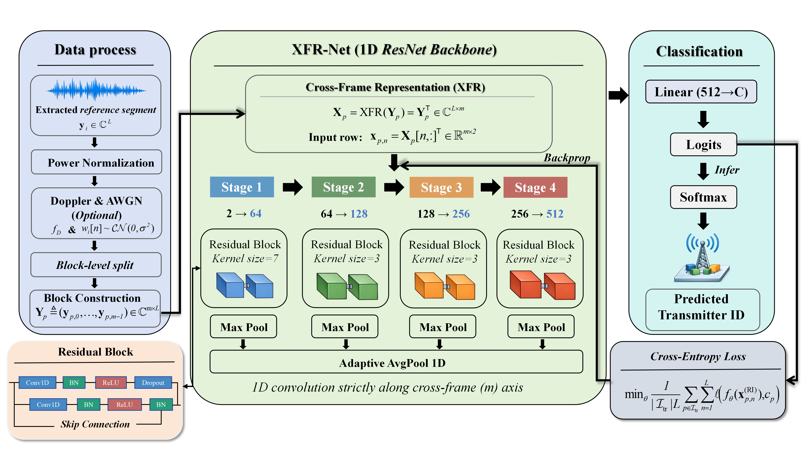

# XFR

This repository contains the official implementation of *XFR: Cross-Frame RFF Representation under Channel Variation and Domain Shift*. We will add the full citation once the paper is accepted.

[Pretrained models](weights/README.md) · [Datasets and evaluation](docs/data.md) · [CD frame schedules](docs/cd-schedules.md)

A receiver observes a transmitter’s hardware fingerprint through a changing channel. XFR stacks repeated receptions of the same aligned reference waveform and transposes the block. Each row then follows one sample position across frames. A 1D convolution sees these observations together and can learn which amplitude and phase patterns persist across receptions.



**XFR-SD** builds a block from successive frames in one recording. **XFR-CD** builds it from receptions of the same transmitter across domains, such as different receivers. Both give the classifier access to every complex sample in the block.

## Run a pretrained model

For the WiSig 20 dB experiment, create a `data/` directory in the repository root. Save [wisig-test.npz](https://github.com/KFC-seven/MW-RFF/releases/download/v1.0.0/wisig-test.npz) in `data/` and [wisig-20db.zip](https://github.com/KFC-seven/MW-RFF/releases/download/v1.0.0/wisig-20db.zip) in `weights/`. The evaluator reads both files directly. Run these commands with Python 3.10.

```shell
python -m pip install -r requirements.txt
python evaluate.py wisig-20db --data data/wisig-test.npz
```

The five checkpoints give a mean row accuracy of approximately **96.75%**. [Models and test sets by paper table](weights/README.md) · [All evaluation commands](docs/data.md)

## Use XFR on your signals

For a recording of aligned reference segments, the SD construction takes two steps.

```python
from xfr.representation import contiguous_blocks, cross_frame_rows

blocks = contiguous_blocks(references, m=256)  # references has shape [frames, samples]
rows = cross_frame_rows(blocks)                # rows[b, n] follows sample n across frames
```

For CD, use `cd_blocks` from `xfr.schedules` and supply one reference array per domain. Run `python examples/cd_schedules.py` to see how the three schedules order frames from different receivers. [CD examples](docs/cd-schedules.md)
